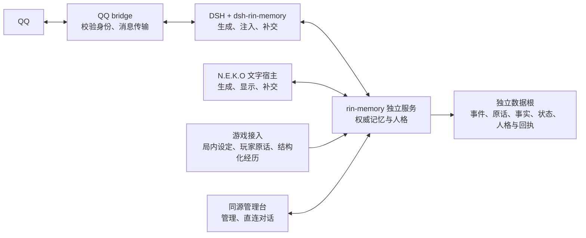
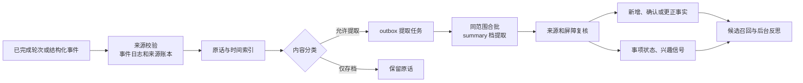

# RIN 记忆流程

本文描述当前源码中原话、事实、召回、采用、成长和清理如何衔接。各环境的安装和验收状态集中在 [维护台账](roadmap.md)，HTTP 字段与运行配置见 [独立服务](standalone-service.md) 和 [管理台与客户端合同](webui-console.md#23-非宿主客户端合同)。

## 1. 服务与接入方的职责

| 入口 | 生成与采用 | 写回 |
|---|---|---|
| 管理台直连 | `ChatBridge` 调用服务的 `MemoryApi.chat`。服务取当前发布人格和本轮记忆，再用 `conversation` 档生成 | 服务直接提交用户原话和回复。历史从核心原始记录读取 |
| DSH / QQ 主人 | bridge 提供已校验绑定和原话。`dsh-rin-memory` 在 DSH 装配前准备人格与上下文，DSH 自己生成。QQ 主会话的操作任务由独立工作会话承接 | 通过 bridge 报告的最终可见回复提交 `POST /v1/turns`，另记录平台接受的分段 |
| DSH / QQ 好友 | 默认走预设会话。QQ Bridge 设置开启「好友记忆与续聊压缩」且服务端授权对应 `qq-friend:<QQ号>` 后，共用事实召回与换段链路。公开人设在人格卡页维护，留空采用 QQ 预设 | 写入好友自己的事实范围。群聊沿用预设会话 |
| N.E.K.O 文字端 | `main_logic/remote_memory.py` 读取并预约上下文，宿主生成文字。发布人格放入 system，召回与更正作为有来源的背景 | 生成后先写宿主补交队列，再交 `POST /v1/turns`。实际显示由宿主报告 |
| NekoSpire 游戏 | `main_logic/game_memory.py` 在接管或新局读取发布人格，正常游玩期间固定版本。打法、构筑和局内决策归插件 | 通过 `POST /v1/events` 提交玩家原话或共同经历，保留游戏、局次和来源 |

一个正式数据根由一个服务进程持有 `.rin_memory.root.lock`。常用工作区运行根为 `companion-runtime`，其中 `memory` 保存核心数据，`host` 保存 N.E.K.O 数据，`state` 保存服务与宿主运行状态，`logs` 保存各端日志。桌宠、游戏、DSH 和管理台通过服务共享权威记录。

### 身份、时间和适用范围

| 字段 | 用途 |
|---|---|
| `character_id`、`subject` | 数据归属。主人一般为 `private`，每个获授权好友有独立 subject |
| `client_id`、`session_id` | 接入身份与会话边界。服务据此校验上下文凭据、补交和回执 |
| `scene` | 原话或事件在哪里发生。游戏、插件、会话信息可保留用于追溯和筛选 |
| `applies_to` | 事实可用于哪些场景。QQ 聊天和游戏中提到的生活偏好可共享，明确限定游戏或局次的经历按限制使用 |
| `request_id`、`source_key`、`message_ref` | 分别标识整轮请求、事件来源和具体原话。同键重试复用首次输入与业务时间 |
| `occurred_at`、`episode_id` | 事件实际发生的时间及经历归组。稍后处理、补交和重放沿用原时间 |

## 2. 原话如何保存并变成记忆

1. **接收和提交。** 管理台由 `POST /v1/chat` 生成并提交，外部聊天用 `POST /v1/turns` 提交已完成回复，插件事件用 `POST /v1/events`。`TurnCommitService` 在整轮结果提交前保存原话并建立提取意图。事件通过 journal 和来源账本去重，原话进入 `recent.json` 与 SQLite 时间索引。重启先回放，再续跑待处理工作。已提交的同键请求返回已存结果，同键改正文会冲突。
2. **分类和排队。** 原始存档与事实提取分开。明确要求记住的第一人称长期陈述可以直接按原话保存。明确说「记错了」或陈述过敏等长期限制时，服务唤醒后台并单独提取这一轮，同范围更早的待处理原话按顺序先处理。普通提取按角色、主体、客户端、会话、场景分组，同时保持经历与分类边界。当前工作区配置为 5 轮、16 条消息、120 秒空闲，维护间隔 60 秒。
3. **筛选长期价值。** 单轮和合批复用规则。稳定事实、明确偏好、长期限制、有实际结果的共同经历可以进入事实；计划与完成、取消进入事项状态。普通追问、调侃、临时指令、未获接受的建议以及角色随口表达留在对话里。符合来源约定的结构化插件经历可以直接保存。
4. **比对和复核。** 同批模型调用带入最多 12 条同主体、场景相容的有效旧事实供比对。更早对话可消解指代。新事实的支持来自本批真实原话，模型给出的 `sources` 和 `message_refs` 必须能还原到说话者与时间。提交前检查删除、更正和目标记录版本。成功提取零条会完成任务；模型失败或引用不合法保留重试状态。
5. **写入事实与派生状态。** 已明确的事项由状态服务维护，关闭后退出当前待办。兴趣信号保留原话和主体，供后续候选与演化取材。好友路径只处理自己的事实。工作摘要按事实、成长、事项和经历重建，管理台可以查看完整视图。

### 三种事实操作

| 操作 | 何时使用 | 写入结果 |
|---|---|---|
| `add` | 有独立新内容或补充限制 | 新事实带来源、保留等级和适用范围。补充只写新增部分 |
| `confirm` | 新用户原话确认同一条认识 | 保留原记录正文和已有有效等级，合并独立来源。按仍有效的用户证据取最新 `last_confirmed_at` |
| `correct` | 用户指出旧认识记错 | 旧事实失效。长期更正生成带来源的新事实，可查询和再次更正。临时更正按有效期走约束通道 |

偏好随时间改变时保留有时间的陈述。日常提及、模型复述、注入和后台整理不刷新用户确认时间。

### 数据怎样分层

| 记录 | 主要内容 |
|---|---|
| `events.ndjson`、来源账本、`turn_requests.json` | 事件回放、来源去重、整轮结果及重试 |
| `recent.json`、`time_indexed.db`、`outbox.ndjson` | 近期原话、时间检索与待提取工作 |
| `facts.json`、`facts_archive.json`、`companion_state.json` | 事实、归档事实与当前事项或角色状态 |
| `reflections.json`、`interest_signals.json`、工作摘要 | 反思、兴趣证据与可重建的阅读投影 |
| `persona_card.json`、`persona_versions.json` | 可编辑人格卡、发布版本及采用记录 |
| `outputs.json`、`memory_consumer_refs.json`、更正与删除记录 | 输出、投递恢复、消费副本与失效依据 |

### 保留等级与历史

| `retention_class` | 用途 | 半衰期 / 最低系数 |
|---|---|---|
| `durable` | 稳定身份、长期偏好或限制 | 不按时间降权 |
| `shared_important` | 有重要结果、持续影响或明确纪念意义的经历 | 365 天 / 0.6 |
| `normal` | 有后续用途的普通事实或经历 | 90 天 / 0.3 |
| `daily` | 短期有用的日常信息 | 7 天 / 0.05 |
| `transient` | 短时材料 | 1.5 天 / 0 |

表中半衰期以重要性 5 为基准。旧记录缺字段时按现有证据、状态和时间保守读取。普通事实以原始业务时间和有效用户确认作为锚点，共同经历优先用事件时间。自然淡出影响日常采用，明确历史查询可找回仍有效的材料。

## 3. 下一轮如何找到并采用记忆

1. **建立本轮快照。** `POST /v1/context` 接收当前输入和作用域。缺近期输入时从同主体、场景、会话补最多两轮完整原话供筛选；近期对话返回值和筛选输入分别管理。已发布人格、`memory_awareness`、更正、禁提与角色当前状态走各自通道。
2. **检索候选。** `build_turn_context` 对事实、反思和可选成长、未完事项、相关经历和来源背景做范围与删除检查。关键词用 BM25，有查询向量时结合相似度。按底层记录去重和计算淡出，合并最多 12 个候选。明确追问过去时保留低权重历史的检索机会。
3. **按问题选择召回深度。** 独立服务的普通聊天使用直接词项匹配和有限的同义意图，最多采用 3 条、合计 600 tokens。明确回忆、短追问和跨段续聊在预算足够时，交给 `summary` 档从候选 key 中筛选。模型筛选最多 8.5 秒，受 `context_budget_ms` 约束。追问原话或某天发生了什么时，可从同主体、同场景的历史原话补充候选。
4. **签发一份入选清单。** `context.selection` 给出 `version`、`status`、`items`；召回正文、记忆 ID、来源、工作摘要和经历的聊天投影取自同一清单。正常无合格记忆是 `empty`。独立服务在深度筛选失败时可采用直接匹配的候选，必需约束继续使用。删除或更正并发变更使旧结果失效。
5. **按接入方式采用。** DSH 按条渲染、按内容版本去重。`reserve` 持久登记裁剪后实际计划使用的引用；带 `selection_version: 1` 时显式空数组保持为空。材料真正进入会话后记指纹，成功提交带 `memory_selection_adopted`。仍在上下文里的同版本材料可复用，被压缩或换段移除后可以再补。宿主文字端沿用自己的驻留背景去重，网页直连由服务组装本轮提示。
6. **分别记录采用和送达。** `used` 表示采用了生成依据，`sent` 表示平台接受，`delivered` 表示接入方报告实际显示或播放。上下文读取本身不会建立这些回执。

显式查询走单独入口。核心 `recall_memory` 支持关键词和可选向量混合排序，事实查不到时可以查原话。`recall_by_time` 按事件时间窗找材料，并用原话补足。客户端的 `GET /v1/memory/entries` 按权限和主体列出可管理条目。三个入口都受删除和更正约束。

### QQ 私聊跨段

主人私聊和启用记忆的好友私聊共用本节流程。来源、筛选与清理按 QQ 绑定及其对应的记忆主体处理。

QQ 轮次保留完整生成结果供补投。近期和历史助手原话按成功发送的气泡索引补齐，部分发送只出现已发送的正文。Bridge 在换段前确认好友记忆是否可用。关闭、撤销授权或服务暂停记忆时，此前采用过记忆的会话换到纯聊天的新段。服务暂时不可达时，已采用过记忆的会话保留入站待重试。

1. Bridge 在上一轮气泡发完后，把新入站的文字和图片数量交给 DSH 记忆插件。插件结合上一请求的输入用量、回复和输出余量预测压力，预算或空闲触发时沿用 QQ 来源键并开启新的 DSH 会话。原始历史留在原会话。
2. 预算换段最多衔接 30 轮、8000 tokens。空闲或段龄换段时，RIN 用同一轮记忆筛选请求查看最多 6 轮、约 1500 tokens 的旧话摘录。它只返回命中的来源键，问候和新话题返回空。筛选超时后，只有明确续问并命中旧话题词才使用原话。
3. DSH 用有效来源取实际送达的完整交换，普通续聊上限为 12 轮、4000 tokens，明确追问为 20 轮、6000 tokens。新段先问候时，可在本段之后明确追问。原话按发生顺序放在当前输入前面，写入会话后确认采用。删除清理同时处理带入缓冲和已引用这些来源的会话。

## 4. 后台反思、人格与主动输出

### 从事实到人格

- 后台先回放待处理任务，再按配置执行反思合成、晋升和归档，更新工作摘要并处理清理。反思可从时间索引读到完整互动，以具体主题形成认识并保存源事实 ID。
- 成长需要成熟度、真实互动、仍有效且独立的证据。普通事实可长期有用，成为人格修订依据还要通过更严格的门槛。好友事实与主人成长隔离。
- 演化模式为 `off`、`propose`、`auto`。提议模式等待审核，自动模式只在满足门槛时修改允许演化的段落。身份和其他冻结段保持人工控制。草稿修订、发布与接入方采用分别记录，发布后的版本在下一轮采用。
- 明确教导走独立权限入口，从已保存的用户原话形成表达规则。提交复核版本和来源，发布中断可续接。撤回或删除来源会重组受影响的规则和投影。

### DSH 主动交流

DSH 插件从事项状态整理约定与未完事项，并结合任务结果和可分享素材生成联系机会。普通搭话从最近真实收发或主动发信起重新计时，遵守静默、间隔、日限额及一次性随机等待。铃芽可以自行分享感兴趣的内容。到点约定和任务结果单独判断发送资格，每次处理一项。

正文及固定分段先通过 `POST /v1/outputs` 持久保存，再由 QQ bridge 投递。服务用实际接受的片段形成已发生交流，未投递部分可继续恢复。其他宿主可使用核心 `proactive` 接口。

## 5. 更正、删除和暂停怎样贯穿全链路

| 用户意图 | 核心处理 | 接入结果 |
|---|---|---|
| 改正记错的事实 | 指定旧条目，写更正并标记旧事实及相关派生失效 | 后续上下文读到新认识，在途旧依据被拒绝 |
| 忘记一条事实 | 先落删除屏障，再清理目标及受影响副本 | 无关原话可保留，已登记消费的插件按待办清理 |
| 忘记来源或整段经历 | 按来源或经历清理原话、时间索引、待办和派生项 | 只保留有完整证据组支撑的事实。缺少分组的旧记录按一组联合证据处理。同一输入重放受删除屏障拦截 |
| 禁止再提某话题 | 记录提及约束 | 读取该字段的接入方和主动联系流程可采用此约束 |
| 暂停长期记忆 | `service.memory_enabled=false` 在服务启动时生效，停事实提取、召回、近期记忆补充及定时维护 | 普通聊天、原话存档和发布人格继续使用，已有事实和待处理任务保留 |

删除清理按源记录及已采用引用找到受影响副本，插件通过 `cleanup/pending` 获取待办，完成后 `ack`。同轮生成或补交绑定删除和更正版本，版本变化时重取快照，已失效结果可返回 410。日志回放与恢复副本同样受屏障约束。

## 6. 按现象找入口

| 现象 | 先看 |
|---|---|
| 原话已提交但没有事实 | `turn_requests.json` 的提交状态、`recent.json` 和 `outbox.ndjson`。检查分类、维护周期、批次条件及提取失败原因 |
| 记忆已保存但这轮没用到 | 同一 `subject/scene` 的 `context.selection.status`、候选相关性、保留等级和预算。正常空选与超时分开 |
| 服务返回了记忆，DSH 没有再贴 | 本轮是否实际渲染，旧版本是否仍在当前上下文，引用是预约还是已采用 |
| 角色变化已保存但没生效 | 人格草稿 revision、已发布版本、外部使用方的采用回执 |
| 删除后某端还显示旧内容 | 核心删除收据、插件 `cleanup/pending` 与清理确认，按原客户端与会话排查 |
| 启动后功能与源码不同 | 先看已安装包、栈配置的版本钉住值和实际使用的运行根，再查 [维护台账](roadmap.md) |

源码入口依次为 [服务路由](../src/rin_memory/service/server.py)、[整轮提交](../src/rin_memory/domain/turns.py)、[事实提取](../src/rin_memory/domain/extraction.py)、[召回](../src/rin_memory/domain/recall.py)、[上下文及回执](../src/rin_memory/service/protocol.py)、[后台维护](../src/rin_memory/domain/maintenance.py) 与 [删除](../src/rin_memory/domain/deletions.py)。DSH 入口见 [接入仓库](https://github.com/lxl8182/dsh-rin-memory) 的 `index.js`、`memory-client.js` 和 `proactive.js`。
